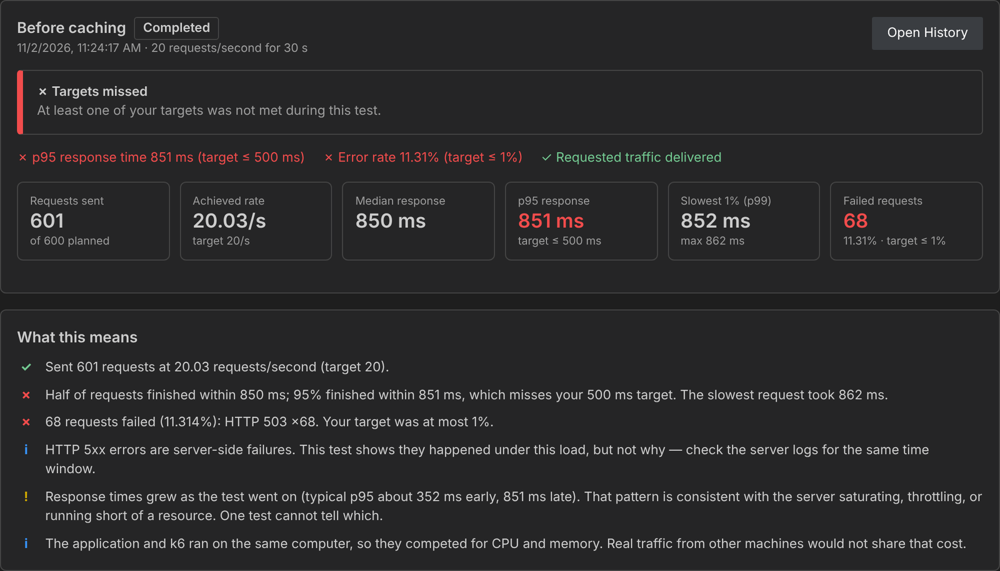
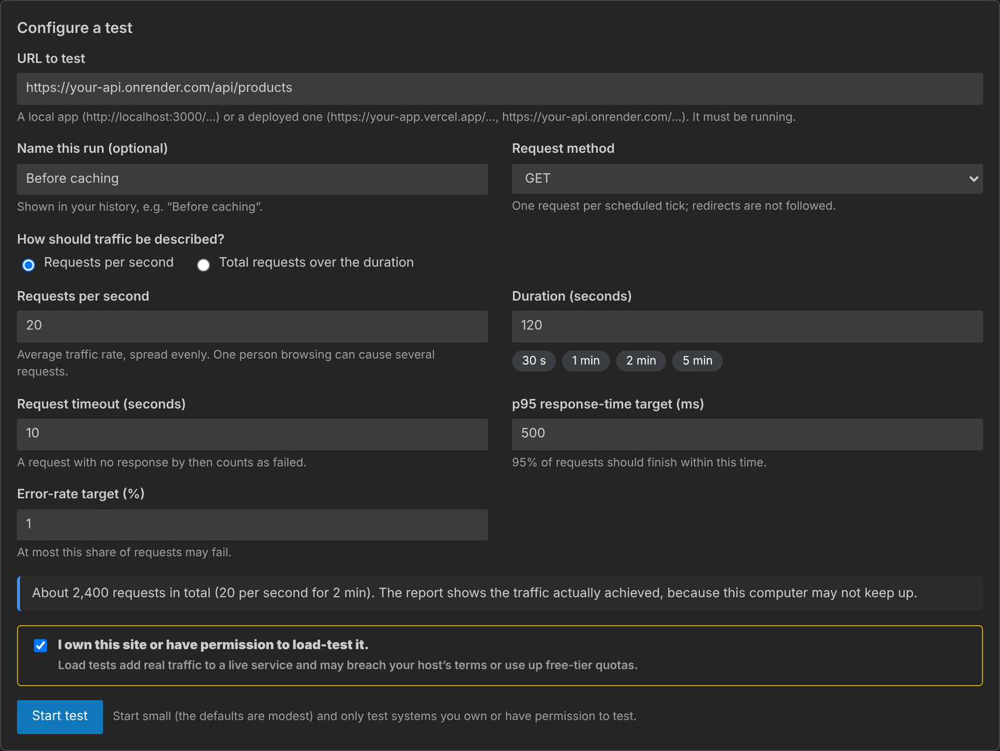
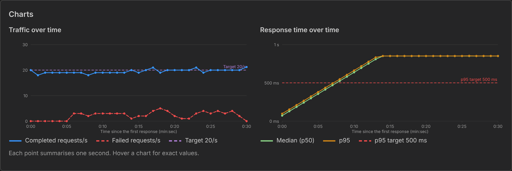
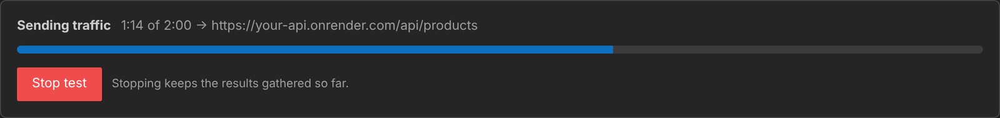
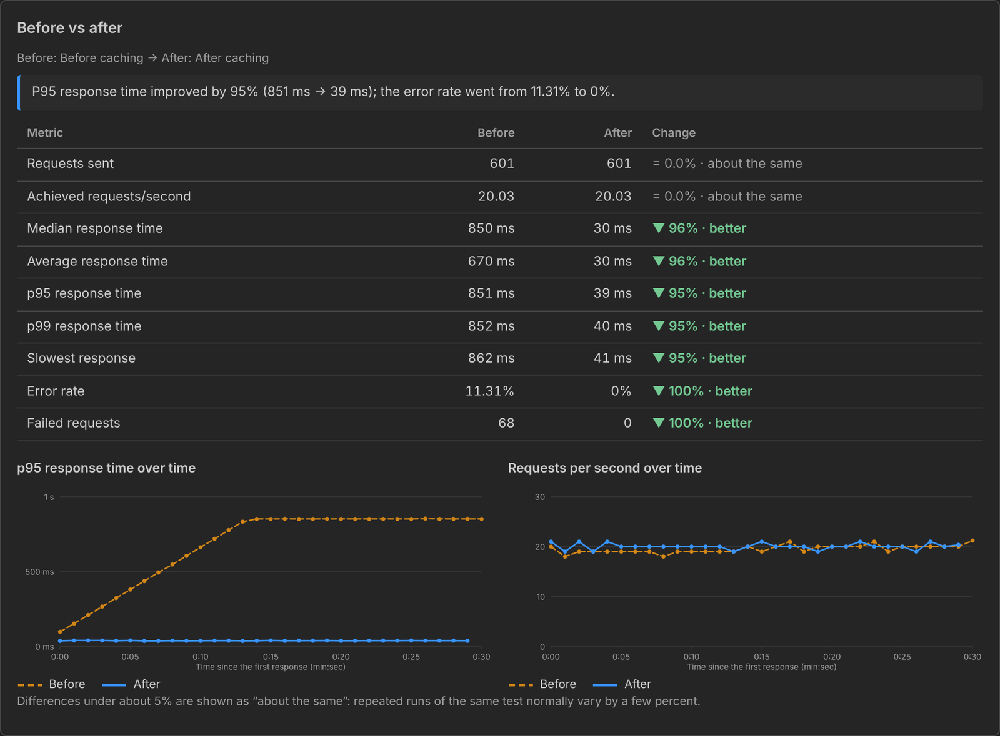
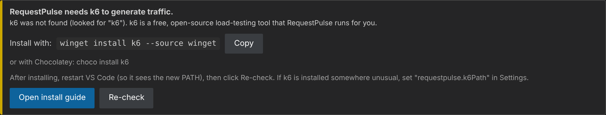

<p align="center">
  
</p>

# RequestPulse — Load Testing for VS Code

> **Apne server ki nabz pehchaano.** Know your server's pulse before your users do.


**Send a controlled wave of traffic to any local or deployed HTTP endpoint, and see exactly how it holds up — response times, errors and throughput — without ever leaving VS Code.**

Works with `localhost`, Vercel, Render, or any URL you own. No accounts, no cloud service, no AI, no telemetry. Everything runs on your machine.



---

## Why RequestPulse?

Most developers find out how their app behaves under load the worst possible way: **launch day**.

Proper load-testing tools are powerful, but they ask you to write scripts, read raw terminal output and work out what the numbers mean. RequestPulse puts the whole workflow inside your editor:

1. **Type a URL**, pick how much traffic and for how long.
2. **Press Start.**
3. **Read a report that explains itself** — in plain language, with a clear pass or fail against *your* targets.
4. **Change your code, run it again, and compare** the two runs side by side.

That last step is the point. It turns "I think caching made it faster" into **"p95 went from 851 ms to 39 ms and errors dropped from 11% to 0%."**

---

## Features

### Describe traffic the way you think about it

Choose **requests per second** (*"20 per second for 5 minutes"*) or a **total number of requests** (*"6,000 over 5 minutes"*). RequestPulse spreads requests evenly across the duration, and the report shows the traffic actually delivered, because your computer may not keep up with high targets.



### Set targets and get a verdict

Give each test two goals: a **p95 response-time target** and a **maximum error rate**. The report tells you whether the endpoint met them.

### A report that explains itself

Every run produces:

- Requests sent, versus the rate you asked for
- Median, p90, p95, p99 and slowest response time
- Failed requests, with a breakdown of status codes, timeouts and connection errors
- **"What this means"** — plain-language findings, such as whether responses slowed down as the test went on, whether the server was rate-limiting you (HTTP 429), or whether the first requests looked like a cold start



Charts have hover tooltips, show your targets as reference lines, and use colour plus line style so they stay readable for everyone.

### Live progress, and a Stop button that actually stops

Watch the progress bar, or stop at any moment. A stopped test keeps the results gathered so far and is clearly labelled as stopped, never passed off as a full run.



### Save every run, then compare before and after

Each test is saved on your computer. Pick any two and get a side-by-side table, a one-sentence summary and overlaid charts. If the two runs used different settings, RequestPulse warns you, because that makes a comparison unfair.



### Built to be safe

- Anything that is not your own computer requires you to **confirm you own the site or have permission to test it**.
- Hard limits: **500 requests/second, 100,000 requests and 1 hour** per test.
- Request timeout and redirects are controlled, and one request is made per scheduled tick.
- Test settings reach k6 through environment variables, never by building a shell command, so a URL can't be turned into code.

---

## Get started in 3 minutes

### 1. Install k6 (once)

RequestPulse uses [k6](https://grafana.com/docs/k6/latest/set-up/install-k6/), a free, open-source load-testing engine from Grafana Labs, to generate the traffic. You don't write any k6 code.

| OS | How to install |
| --- | --- |
| **Windows** | `winget install k6 --source winget` — or `choco install k6` — or download the `.msi` / `.zip` from the [k6 releases page](https://github.com/grafana/k6/releases/latest) |
| **macOS** | `brew install k6` |
| **Linux** | Follow the [official install guide](https://grafana.com/docs/k6/latest/set-up/install-k6/) |

Restart VS Code afterwards so it picks up the new PATH. Installed k6 somewhere unusual (for example, you unzipped it)? Set the full path to `k6.exe` in the **`requestpulse.k6Path`** setting.

If k6 is missing, RequestPulse tells you and shows exactly what to do:



### 2. Open the dashboard

Press `Ctrl+Shift+P` (`Cmd+Shift+P` on macOS) and run:

**`RequestPulse: Open Dashboard`**

The badge at the top right should say **k6 ready**.

### 3. Run your first test

1. Start your app, or have a deployed URL ready.
2. Enter the URL, for example `http://localhost:3000/api/products`.
3. Choose a modest rate (10 requests per second for 30 seconds is plenty to begin).
4. Click **Start test**.

Start small. You can always go bigger.

---

## What can I use it for?

| Situation | How RequestPulse helps |
| --- | --- |
| **"Will my site survive launch day?"** | Send the traffic you expect, and see whether your response-time and error targets hold |
| **"Did my optimisation actually work?"** | Run before, change the code, run after, and compare |
| **"Is my free Render or Vercel plan enough?"** | See how your API behaves under steady traffic, and spot slow cold starts at the start of a test |
| **"Is this new endpoint fast enough?"** | Check it before you ship, with a pass or fail against a target you chose |
| **"How does my local build behave?"** | Test `localhost` with no permission prompt and no hosting costs |
| **"What happens during my busy hours?"** | Run a test at the rate you see at peak time, for as long as that peak lasts |

---

## Reading the results

| Term | What it means |
| --- | --- |
| **Requests/second** | How many requests were completed each second on average. Compare *achieved* against *target* |
| **Median (p50)** | Half of requests were faster than this. A "typical" request |
| **p95** | 95% of requests were faster than this. Shows what your slower users see, and is the usual target to set |
| **p99** | The slowest 1% start here. Spikes and rare slow paths show up here |
| **Error rate** | The share of requests that failed: HTTP 4xx/5xx, timeouts or connection errors |
| **Timeout** | No response arrived within your request timeout, so the request counts as failed |
| **HTTP 429** | The server or its host is rate-limiting you. The app may be fine; the limit may be protecting it |

**Requests are not users.** One visitor loading a page can trigger dozens of requests, so "20 requests per second" is not "20 users".

---

## Commands and settings

| Command | What it does |
| --- | --- |
| `RequestPulse: Open Dashboard` | Opens the dashboard |
| `RequestPulse: Stop Running Test` | Stops the current test (also available by clicking the status bar item while a test runs) |
| `RequestPulse: Check k6 Installation` | Verifies k6 is found and shows its version |
| `RequestPulse: Open Saved Reports Folder` | Opens the folder where your results are stored |

| Setting | Default | Description |
| --- | --- | --- |
| `requestpulse.k6Path` | `k6` | Path to the k6 executable. Change it only if k6 is not on your PATH. Set this in your **User** settings; workspace settings are ignored on purpose, so a project can't choose which program runs |

---

## Be honest about what a test can tell you

A load test is only as meaningful as its conditions. RequestPulse keeps these limits visible, and you should too:

- **Your computer and network are part of the test.** Requests start from your machine, so results include the path from you to the server. If the app and k6 run on the same PC, they compete for CPU.
- **One test is not "maximum capacity".** It shows how an endpoint behaved under *one* traffic pattern. To find a limit, run several tests at increasing rates and see where your targets stop being met.
- **A URL does not reveal server CPU or memory.** RequestPulse sees responses, not what is happening inside the server.
- **Slow does not mean "the database".** The report says what happened, not why. Use your server logs for the same time window to find the cause.
- **Free hosting has quotas.** Vercel, Render and similar plans have usage limits, and Render's free services sleep when idle, so the first requests of a test can be slow.
- **Test traffic is real traffic.** If your site counts page views on the server, a test will count too. See the FAQ.

---

## Responsible use

Only test systems **you own or have explicit permission to test**. Load tests add real traffic to live services, can use up quotas, and may breach a host's terms of service. RequestPulse is built for testing your own applications. It is not a tool for attacking anyone else's, and it won't ask you to hide who is sending the traffic.

---

## Privacy

- **Nothing leaves your computer.** There is no telemetry, no analytics and no account. RequestPulse contacts only the URL you choose to test.
- Results are saved as plain JSON files in the extension's local storage folder. Open it any time with **`RequestPulse: Open Saved Reports Folder`**.
- RequestPulse turns off k6's own usage reporting.
- URLs containing a username or password are rejected, so credentials are never saved to disk.

---

## FAQ

**Do I need to know k6?**
No. RequestPulse writes and runs the test for you. You only need k6 installed.

**Does it work with Vercel and Render?**
Yes, with any publicly reachable `http://` or `https://` URL. You'll be asked to confirm you have permission to test it.

**Will a test count towards my site's visitor counter?**
It depends on how the counter works. RequestPulse sends plain HTTP requests and **does not run JavaScript**. A counter that increments **on the server** when a URL is requested (middleware, a route handler, a GET endpoint) **will** count test requests. A counter that increments from **browser JavaScript**, or from third-party analytics, **won't**. Static pages served from a CDN never reach your code, so they won't count either. If you don't want test traffic counted, test against `localhost` or a staging copy.

**Why only GET and HEAD?**
This version tests read endpoints. Logins, forms and multi-step journeys are on the wishlist below.

**Why can't I send more than 500 requests per second?**
A single laptop or home connection can't reliably produce more, and results above that would mostly measure your own machine. The limits keep tests honest and protect other people's services.

**The report says my target "was not fully delivered". What does that mean?**
k6 could not send requests as fast as you asked, because it ran out of virtual users (usually because responses were slow and requests piled up) or because this computer or network was the bottleneck. Treat the response times with care: the server saw less traffic than you requested.

**Can I test an app that needs a login?**
Not yet. Version 1 tests URLs that don't need authentication.

---

## Troubleshooting

| Problem | What to try |
| --- | --- |
| The badge says **k6 not found** | Install k6, restart VS Code, then click **Re-check**. If k6 is installed but not on your PATH, set `requestpulse.k6Path` to the full path of `k6` / `k6.exe` |
| Command isn't in the palette | Run **Developer: Show Running Extensions** and check RequestPulse is listed. Reload the window |
| Every request fails with "no connection" | Your app isn't running, or the URL or port is wrong. Open the URL in a browser first |
| All requests return 404 / 401 / 403 | The path is wrong or the endpoint needs a login. Fix the URL |
| Very slow first seconds, then fast | A cold start: a sleeping free-tier service waking up. Run the test again to see steady-state behaviour |
| The test ends with fewer requests than planned | Your computer or network couldn't keep up. Lower the rate |

Still stuck? Open an issue on GitHub and include the message you see.

---

## Roadmap

Ideas on the list. These are possibilities, not promises:

- Gradually increasing traffic, to find where your targets stop being met
- Multi-step user journeys (log in, browse, add to cart)
- Live-updating charts while the test runs
- POST requests and custom headers
- Exporting a report as HTML or CSV
- Scheduled tests

Want one of these sooner? Tell me by opening an issue.

---

## Platforms

Automated tests run on Linux with k6 1.6. The dashboard and k6 detection have also been checked on Windows 11. macOS uses the same code and has not been tested yet. If something misbehaves on your system, please report it.

---

## Contributing

Issues and pull requests are welcome.

```bash
git clone https://github.com/parth-0702/requestpulse.git
cd requestpulse
npm install
# Press F5 in VS Code to launch an Extension Development Host
npm test          # unit tests; end-to-end tests run automatically when k6 is installed
```

---

## Credits and licence

RequestPulse is released under the [MIT licence](LICENSE).

Traffic is generated by [k6](https://k6.io), an open-source project by Grafana Labs. *k6 is a trademark of Grafana Labs. RequestPulse is an independent project and is not affiliated with or endorsed by Grafana Labs or Microsoft.*

**If RequestPulse helped you catch a problem before your users did, a review on the Marketplace goes a long way.**
